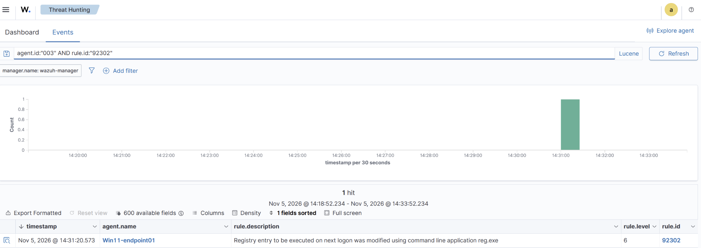
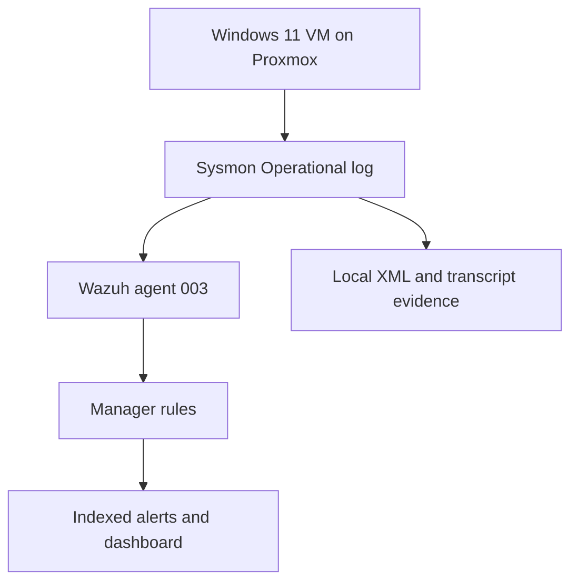

# Windows endpoint investigation: Run key detection and PowerShell alert triage

**Author:** Edilberto Rodriguez · **Case:** LAB-WIN-002 · **Date:** November 5, 2026  
**Environment:** Authorized Windows 11 lab on Proxmox, Sysmon, Wazuh 4.14.1

Investigated a high-severity file-creation alert, correlated it with a benign PowerShell execution, and tested detection of a per-user registry Run value. The final `reg.exe` modification generated Wazuh rule **92302 (level 6)**. Cleanup was verified through a failed value query and Sysmon **12 / DeleteValue**.

The earlier PowerShell registry writes were present locally but had no visible matching alert. Inspection of the installed rules identified a writer-specific condition in rule 92302. Separate agent buffer warnings required collection tuning; they do not prove that those particular events were lost.

| Question | Evidence-based result |
| --- | --- |
| Did a child PowerShell process run? | Yes: Sysmon 1, PID 1640; same console window does not imply the same process. |
| Was the level-15 alert a malicious download? | No supporting evidence. Its file was a PowerShell policy probe associated with the authorized process. |
| Was a Run value created? | Yes: Sysmon 13 and registry query. |
| Was the final modification detected centrally? | Yes: rule 92302, same event record 2736761. |
| Was persistence activated at sign-in? | Not tested. Registration/modification was demonstrated. |
| Was the test value removed? | Yes: Sysmon 12, record 2736819, plus query returning not found. |

## Investigation materials

- [Investigation report](report.md): reasoning, findings, limitations and cleanup.
- [UTC timeline](timeline.csv) and [all 286 selected event rows](timeline-all-selected-events.csv).
- [Detection queries and installed rule analysis](detection-notes.md).
- [Evidence index](evidence/INDEX.md): all 30 renamed screenshots and original files.
- [Original Windows export](evidence/original/evidence/sysmon-case-events.xml), [transcript](evidence/original/evidence/execution-transcript.txt), and [marker script](evidence/original/lab-marker.ps1).
- [Integrity validation](validation.md) and [publication guidance](publication-notes.md).

## Lab context

| Component | Identity |
| --- | --- |
| Endpoint agent | Win11-endpoint01 / 003 / 10.10.60.61 |
| Windows hostname and user | DESKTOP-P4H3Q32 / WinLab |
| Wazuh manager | wazuh-manager / node01 |
| Sysmon | 15.22; Windows PowerShell 5.1 |
| Working folder | `C:\SOC-Lab\LAB-WIN-002-20261105-131452` |

This is a controlled detection-validation case, with no observed compromise. ATT&CK metadata describes the modeled behavior; it is not evidence of an adversary or actual privilege escalation. The abandoned November 4 attempt is excluded.
